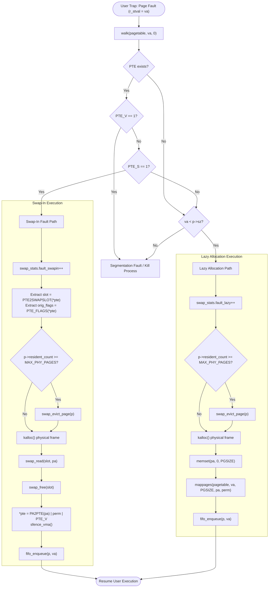

# Architecture Specification: Virtual Memory & Page Swapping Subsystem

This document provides the definitive architectural specification for the demand paging and page replacement subsystem in xv6-RISC-V (Sv39). It outlines data structures, storage representations, page table layouts, fault handling pipelines, hardware synchronization barriers, and the modular replacement policy engine.

---

## 1. Storage Architecture & Disk Layout

xv6 utilizes a raw VirtIO block device with a block size of $BSIZE = 1024$ bytes (`1 KB`). The virtual memory subsystem operates at a page granularity of $PGSIZE = 4096$ bytes (`4 KB`). Consequently, each swap slot exactly spans:

$$\text{Blocks per Page} = \frac{PGSIZE}{BSIZE} = \frac{4096}{1024} = 4 \text{ contiguous disk blocks}$$

### Disk Partitioning

The disk layout is defined in [src/kernel/param.h](file:///data/rspace/codespace/projects/xv6-swap/src/kernel/param.h):

```
+--------------------------+-------------------------------------------------------+
| File System Area         | Swap Backing Store Area                               |
| Blocks 0 .. 1999         | Blocks 2000 .. 9999                                   |
| (FSSIZE = 2000 blocks)   | (SWAPBLOCKS = 8000 blocks -> NSWAPSLOTS = 2000 slots) |
+--------------------------+-------------------------------------------------------+
0                          2000 (SWAPSTART)                                        10000
```

- `SWAPSTART = FSSIZE = 2000`: Sector offset where swap space begins.
- `SWAPBLOCKS = 8000`: Disk blocks designated for swap backing storage.
- `NSWAPSLOTS = SWAPBLOCKS / BLOCKS_PER_PAGE = 2000`: Total independent 4 KB page frames that can reside on disk simultaneously.

### Swap Slot Disk Address Calculation

Given a swap slot number $k \in [0, \text{NSWAPSLOTS} - 1]$, the starting disk block $B_k$ is computed as:

$$B_k = \text{SWAPSTART} + k \times \text{BLOCKS\_PER\_PAGE} = 2000 + 4k$$

Disk I/O is performed synchronously via the buffer cache (`bread()`, `bwrite()`, and `brelse()`) in [src/kernel/swap.c](file:///data/rspace/codespace/projects/xv6-swap/src/kernel/swap.c#L63-L99) across the 4 contiguous blocks: $\{B_k, B_k+1, B_k+2, B_k+3\}$.

---

## 2. Swap Space Bitmap Allocator

Swap space allocation uses a 1-bit-per-slot in-memory bitmap protected by a kernel spinlock:

```c
static uchar swap_bitmap[NSWAPSLOTS / 8 + 1];
static struct spinlock swap_lock;
```

- **Bit Value `0`:** Swap slot is unallocated / free.
- **Bit Value `1`:** Swap slot is occupied by a swapped-out page.

### Allocator Operations
1. **`swap_alloc()`**:
   - Acquires `swap_lock`.
   - Performs a linear scan over bits $0 \dots \text{NSWAPSLOTS}-1$.
   - Sets the first found zero-bit to 1 and returns the slot index $k$.
   - Returns `-1` if all 2000 slots are exhausted.
   - Releases `swap_lock`.
2. **`swap_free(int slot)`**:
   - Validates $0 \le \text{slot} < \text{NSWAPSLOTS}$.
   - Acquires `swap_lock`.
   - Asserts bit is 1 (panics on double-free).
   - Clears bit to 0 and releases `swap_lock`.

---

## 3. RISC-V Sv39 Page Table Entry (PTE) Encoding

In RISC-V Sv39 architecture, virtual addresses are 39 bits wide (translated via a three-level page table tree), and PTEs are 64 bits wide.

### Standard Resident Hardware PTE Format
```
 63      54 53                             10 9   8 7 6 5 4 3 2 1 0
+----------+---------------------------------+-----+---+-+-+-+-+-+-+
| Reserved | Physical Page Number (PPN)      | RSW | D |A|G|U|X|W|R|V|
| (10 bits)| (44 bits)                       | (2) | 1 |1|1|1|1|1|1|1|
+----------+---------------------------------+-----+---+-+-+-+-+-+-+
```
- `V` (bit 0): Valid bit. Hardware MMU checks this bit during address translation.
- `R, W, X` (bits 1..3): Read, Write, Execute permission flags.
- `U` (bit 4): User accessible.
- `G` (bit 5): Global mapping.
- `A` (bit 6): Hardware Accessed bit. Set by MMU upon read/write/instruction fetch.
- `D` (bit 7): Hardware Dirty bit. Set by MMU upon page write.
- `RSW` (bits 8..9): Reserved for Supervisor Software. Unused by hardware.

### Swapped-Out PTE Encoding (RSW Bit 8: `PTE_S`)
When a resident page is evicted to swap, its physical frame is reclaimed (`kfree`), and the PTE is converted to represent the swapped state:
```
 63                         32 31           10 9   8 7 6 5 4 3 2 1 0
+-----------------------------+---------------+-----+---+-+-+-+-+-+-+
|          Reserved           | Swap Slot No. | RSW | D |A|G|U|X|W|R|V|
|          (32 bits)          | (22 bits)     | 0 1 | 0 |0|0|1|x|x|x|0|
+-----------------------------+---------------+-----+---+-+-+-+-+-+-+
                                               ^   ^                 ^
                                            bit 9  bit 8 (PTE_S)    bit 0 (PTE_V = 0)
```

The encoding satisfies three invariants:
1. **Hardware MMU Invalidation:** Bit 0 (`PTE_V`) is set to `0`. Any user-space access immediately traps to the kernel with a Page Fault (`scause` 13 or 15).
2. **Software Signature:** Bit 8 (`PTE_S = 1L << 8`, inside the supervisor RSW field) is set to `1`. This distinguishes a swapped-out page from a lazily allocated or completely unmapped page.
3. **Slot Identification & User Permissions:**
   - Swap slot index ($0 \dots 1999$) is stored in bits 10..31: `(slot & 0x3FFFFF) << 10`.
   - User permissions (`PTE_R | PTE_W | PTE_X | PTE_U`) are preserved in bits 1..4 so they can be restored upon swap-in without reconsulting metadata.

### Encoding Macros ([src/kernel/riscv.h](file:///data/rspace/codespace/projects/xv6-swap/src/kernel/riscv.h#L403-L415))
```c
#define PTE_S            (1L << 8)         // Swapped to disk (software bit in RSW)
#define SWAP_SLOT_MASK   0x3FFFFF          // 22 bits
#define ENCODE_SWAP_PTE(slot, flags) \
    ((((uint64)(slot) & SWAP_SLOT_MASK) << 10) | ((flags) & 0x3FF) | PTE_S)
#define PTE2SWAPSLOT(pte) (((pte) >> 10) & SWAP_SLOT_MASK)
```

---

## 4. Demand Paging & Page Fault Pipeline (`vmfault()`)

When user space attempts to read, write, or execute an address whose PTE has `PTE_V == 0`, the RISC-V hart generates an exception:
- `scause = 13`: Page Load Fault
- `scause = 15`: Page Store/AMO Fault

The trap handler in [src/kernel/trap.c](file:///data/rspace/codespace/projects/xv6-swap/src/kernel/trap.c) catches the fault, extracts the offending address from `r_stval()`, and invokes `vmfault(p->pagetable, p->sz, va, is_read)`.

### Flowchart: Page Fault Resolution



### TLB Synchronization Barrier (`sfence_vma`)
The RISC-V translation lookaside buffer caches address translations and flag bits (including `PTE_V`, `PTE_A`, and `PTE_D`).
Any modification to active page tables mandates an immediate synchronization barrier:
```c
sfence_vma();
```
- **Eviction:** After clearing `PTE_V` and writing `ENCODE_SWAP_PTE`, `sfence_vma()` guarantees subsequent memory references will trap instead of hitting stale TLB entries.
- **Reference Bit Sweeping:** When clearing `*pte &= ~PTE_A` in Clock algorithms, `sfence_vma()` ensures the MMU does not rely on a cached `A=1` entry and sets `PTE_A` in the page table on subsequent access.
- **Swap-In:** After writing `*pte = PA2PTE(mem) | perm | PTE_V`, `sfence_vma()` guarantees the hardware MMU fetches the new valid PTE mapping.

---

## 5. Per-Process Resident Set Management

xv6 enforces a per-process resident physical page limit defined in [src/kernel/param.h](file:///data/rspace/codespace/projects/xv6-swap/src/kernel/param.h#L19):

```c
#define MAX_PHY_PAGES 16
```

Tracking structures are embedded directly in `struct proc` in [src/kernel/proc.h](file:///data/rspace/codespace/projects/xv6-swap/src/kernel/proc.h#L102-L106):
```c
struct proc {
  ...
  uint64 resident_pages[MAX_PHY_PAGES]; // Virtual addresses of mapped user pages
  uint8  access_history[MAX_PHY_PAGES]; // 8-bit recency shift register / multi-touch counter
  uint8  ref_frequency[MAX_PHY_PAGES];  // 4-bit saturating frequency counter (0..15, FREQ_AGING)
  uint8  is_protected[MAX_PHY_PAGES];   // Partition tag: 0 = Probationary T1, 1 = Protected T2 (CAR_2Q)
  int    clock_hand;                    // Scanning hand / FIFO head index
  int    resident_count;                // Number of currently resident physical pages (0..16)
  ...
};
```

- When a new page is mapped (`vmfault`, `sbrk`, or `exec`), `fifo_enqueue(p, va)` appends the virtual address and initializes `access_history[tail] = 0x80`.
- When a victim page is selected, `fifo_remove(p, va)` compacts the remaining array elements and decrements `resident_count`.

---

## 6. Replacement Policy Specifications

The replacement engine separates the **mechanism** (I/O transfer, bitmap allocation, PTE encoding, TLB shootdown in `swap_evict_page()`) from the **policy** (`select_victim_page()`).

Compile-time selection is controlled via `src/Makefile`:
```make
# Options: FIFO, CLOCK, ENHANCED_CLOCK, ADAPTIVE_CLOCK, CAR_2Q, FREQ_AGING, DYNAMIC_BIAS, TIMER_AGING
POLICY ?= ADAPTIVE_CLOCK
```

```
                                  +---------------------------------------------+
                                  |           swap_evict_page(proc)             |
                                  +----------------------+----------------------+
                                                         |
                                                         v
                                  +---------------------------------------------+
                                  |             select_victim_page()            |
                                  +----------------------+----------------------+
                                                         |
       +-------------------------------------------------+-------------------------------------------------+
       |                                                                                                   |
       v                                                                                                   v
[Phase I Baselines]                                                                               [Phase II Research Candidates]
  ├── Policy 0: FIFO (Circular arrival queue)                                                       ├── Policy 4: CAR_2Q (Probationary T1 + Protected T2)
  ├── Policy 1: CLOCK (1-bit second chance sweep)                                                   ├── Policy 5: FREQ_AGING (4-bit saturating LFU + 8-bit recency)
  ├── Policy 2: ENHANCED_CLOCK (4-Class Accessed + Dirty)                                           ├── Policy 6: DYNAMIC_BIAS (Sliding window fault velocity tracker)
  └── Policy 3: ADAPTIVE_CLOCK (8-bit decaying shift register + static dirty bias)                  └── Policy 7: TIMER_AGING (Timer-driven background decay + fast path)
```

---

### Policy 0: First-In, First-Out (FIFO)
- **Concept:** Oldest resident page frame is evicted first, regardless of access frequency or recency.
- **Algorithm:**
  1. Inspect queue head at `p->clock_hand` (typically index 0 in the compacted queue).
  2. Select `va = p->resident_pages[p->clock_hand]`.
  3. Evict page and remove from resident list.
- **Characteristics:** Suffers from Belady's Anomaly and thrashing on cyclical reference patterns. Serves as our experimental control baseline.

---

### Policy 1: Second-Chance Clock
- **Concept:** Uses the hardware-managed `PTE_A` (Accessed) bit to give recently referenced pages a second chance.
- **Algorithm:**
  1. Let `attempts = 0`, `max_attempts = 2 * p->resident_count + 1`.
  2. For candidate index `idx = p->clock_hand`:
     - Advance `p->clock_hand = (p->clock_hand + 1) % p->resident_count`.
     - Inspect PTE: `pte = walk(p->pagetable, va, 0)`.
     - If `*pte & PTE_A`:
       - Clear reference bit: `*pte &= ~PTE_A`.
       - Flush TLB: `sfence_vma()`.
       - Grant second chance; continue loop.
     - Else (`PTE_A == 0`):
       - Select `va` as victim. Return immediately.
  3. If loop exhausts `max_attempts`, evict candidate at original hand.
- **Theoretical Bound:** At most two complete revolutions around the circular buffer ($2N$).

---

### Policy 2: Enhanced Clock (4-Class Accessed + Dirty)
- **Concept:** Acknowledges the asymmetry of I/O cost between clean pages (discardable if backed elsewhere, or low I/O overhead) and dirty pages (requiring expensive disk writes).
- **Classification Matrix:**
  - **Class 0 `(0, 0)`:** Neither recently accessed nor dirty $\rightarrow$ *Best victim*.
  - **Class 1 `(0, 1)`:** Not recently accessed, but dirty $\rightarrow$ *Second best victim* (requires writeback).
  - **Class 2 `(1, 0)`:** Recently accessed, but clean $\rightarrow$ *Third best victim* (may be accessed again).
  - **Class 3 `(1, 1)`:** Recently accessed and dirty $\rightarrow$ *Worst victim*.
- **Algorithm (Up to 4 Passes):**
  - **Step 1:** Scan from `clock_hand` for `A == 0 && D == 0`. Do **not** modify Accessed bits. If found, evict and advance hand.
  - **Step 2:** Scan for `A == 0 && D == 1`. For every page examined with `A == 1`, clear `PTE_A` (`*pte &= ~PTE_A; sfence_vma()`). If Class 1 candidate is found, evict and advance hand.
  - **Step 3:** Repeat Step 1 looking for Class 0 (`A == 0 && D == 0`). (Pages demoted in Step 2 may now qualify).
  - **Step 4:** Repeat Step 2 looking for Class 1 (`A == 0 && D == 1`). If no victim found, evict at original hand.

---

### Policy 3: Adaptive Clock (Sampled Access History & Aging)
- **Concept:** Combines pseudo-LRU 8-bit decaying shift registers with a dirty write-back penalty bias.
- **Data Structure:**
  - `uint8 access_history[MAX_PHY_PAGES]`: Shift register storing access history over the last 8 eviction epochs.
  - Initialized to `0x80` (`10000000b`) on allocation/enqueue, giving newly loaded pages initial residency protection.
- **Aging & Scoring Transformation:**
  On eviction demand, the algorithm performs a single deterministic $O(N)$ pass over all resident pages:
  $$\text{history}_i = (\text{history}_i \gg 1) \mid (\text{Accessed}_i \ll 7)$$
  $$\text{PTE\_A}_i \leftarrow 0; \quad \texttt{sfence\_vma}()$$
  $$\text{Score}_i = \text{history}_i + (\text{Dirty}_i \,?\, 32 : 0)$$
- **Victim Selection:**
  - Select page with the minimum $\text{Score}_i$.
  - Low history indicates cold/infrequently accessed frames.
  - The $+32$ bias protects dirty frames against clean frames of comparable recency, saving swap disk writes.
  - Advance `clock_hand = (victim_idx + 1) % resident_count`.
- **Complexity:** Exactly $N = 16$ inspections per eviction. Deterministic, loop-free, and cache-friendly.

---

### Policy 4: CAR_2Q (Dual-List Scan-Resistant Clock Policy)
- **Concept:** Inspired by the 2Q and Clock with Adaptive Replacement (CAR) algorithms. Solves the classical cache scan vulnerability where streaming sequential loops flush active, frequently referenced working sets. Partitions the 16 resident frames into a probationary list $T_1$ (absorbs single-touch transient bursts) and a protected list $T_2$ (shields multi-touch hot pages).
- **Data Structures (`struct proc`):**
  - `uint8 is_protected[MAX_PHY_PAGES]`: List membership tag (`0 = T1 Probationary`, `1 = T2 Protected`).
  - `uint8 access_history[MAX_PHY_PAGES]`: Multi-touch frequency counter tracking re-references in $T_1$.
  - Capacity target: `#define CAR_T2_TARGET 12` (allocates up to $75\%$ of resident memory to hot working set pages, leaving at least 4 frames in $T_1$ for transient traffic).
- **Eviction & Promotion / Demotion Pipeline:**
  1. **$T_1$ Probationary Sweep (Primary Search):**
     - If $|T_1| > 0$ and $|T_2| < \text{CAR\_T2\_TARGET}$, scan candidates in $T_1$ starting at `clock_hand`.
     - For each examined candidate:
       - If `PTE_A == 1`: Clear `PTE_A`, issue `sfence_vma()`.
         - If `PTE_D == 1` (Dirty): Immediately promote to $T_2$ (`is_protected = 1`, $|T_2|++$). Rationale: Dirty writebacks are expensive; protecting referenced dirty frames avoids immediate disk write traffic.
         - If `PTE_D == 0` (Clean): Increment `access_history`. If $\ge 2$, promote to $T_2$ (`is_protected = 1`, $|T_2|++$). Otherwise retain in $T_1$ as an eviction candidate.
         - If $|T_2|$ reaches capacity ($\ge 12$) or $T_1$ empties, break to Step 2.
       - If `PTE_A == 0`: Found candidate in $T_1$. Clean frames (`PTE_D == 0`) are evicted immediately. Dirty frames are recorded as fallback candidates if no clean frames appear within 16 iterations.
  2. **$T_2$ Protected Demotion Sweep (Secondary Search):**
     - If no victim was found in $T_1$ or $|T_2| \ge \text{CAR\_T2\_TARGET}$, sweep $T_2$.
     - For each examined candidate:
       - If `PTE_A == 1`: Grant second chance (`PTE_A = 0`, `sfence_vma()`).
       - If `PTE_A == 0`: Demote candidate from $T_2$ to $T_1$ (`is_protected = 0`, $|T_2|--$). Clean demoted frames are evicted immediately; dirty demoted frames are recorded as fallback.
  3. **Guaranteed Bounded Fallback:**
     - Sweep is bounded by $2N + 1$ iterations, guaranteeing deterministic eviction without infinite loops.
- **Complexity & Scan Overhead:**
  - While theoretical worst-case is $O(N)$, dual-list partitioning filters candidates rapidly.
  - Across the entire benchmark suite, `CAR_2Q` completed with **4,335 scan inspections**—a **42.8% reduction in kernel scan overhead** compared to `ADAPTIVE_CLOCK` (7,584 scans).
- **Empirical Leadership:** Achieved the absolute lowest fault count across all 8 evaluated policies: **467 total faults** and **934 swap I/O pages**.

---

### Policy 5: FREQ_AGING (Frequency-Weighted Access Aging / LFU-Recency Blend)
- **Concept:** Blends temporal recency with cumulative reference frequency. Pure LFU suffers from cache pollution by historical frequency bursts that become obsolete; pure LRU cannot differentiate between a page accessed twice and a page accessed 1,000 times within a loop. `FREQ_AGING` pairs an 8-bit recency shift register with an exponentially decaying 4-bit saturating frequency counter.
- **Data Structures (`struct proc`):**
  - `uint8 access_history[MAX_PHY_PAGES]`: 8-bit recency shift register. Initialized to `0x80` on enqueue.
  - `uint8 ref_frequency[MAX_PHY_PAGES]`: 4-bit saturating counter ($0 \dots 15$). Initialized to `1` on enqueue.
- **Aging and Decay Dynamics:**
  On eviction demand, sweeps all resident frames $i \in [0, resident\_count - 1]$ from `clock_hand`:
  - **Referenced (`PTE_A == 1`):**
    - Frequency increment: $\text{ref\_frequency}[i] = \min(15, \text{ref\_frequency}[i] + 1)$
    - Recency shift: $\text{access\_history}[i] = (\text{access\_history}[i] \gg 1) \mid 0x80$
    - Clear `PTE_A` and issue `sfence_vma()`.
  - **Unreferenced (`PTE_A == 0`):**
    - Exponential frequency decay: $\text{ref\_frequency}[i] = \lfloor (\text{ref\_frequency}[i] \times 3) / 4 \rfloor$
    - Recency shift: $\text{access\_history}[i] = \text{access\_history}[i] \gg 1$
- **Composite Scoring Function:**
  $$\text{Score}_i = \text{access\_history}[i] + (\text{ref\_frequency}[i] \times 16) + ((\text{PTE\_D}_i) \mathrel{?} 32 : 0)$$
  - Multiplier $\times 16$ weights frequency into the upper nibble while recency informs the lower range.
  - Dirty penalty $+32$ disfavors expensive disk writebacks.
  - Page with the minimum $\text{Score}_i$ is evicted; tie-breaking follows clock hand traversal order.
- **Complexity:** Deterministic single-pass $O(N)$ with exactly $N = 16$ candidate inspections per eviction.
- **Empirical Findings:** Matches `ADAPTIVE_CLOCK` at **474 total faults** and **948 swap I/O pages**, validating that exponential frequency decay prevents stale frequency traps.

---

### Policy 6: DYNAMIC_BIAS (Sliding Window Fault Velocity Sensitive Dirty Writeback Bias)
- **Concept:** Static dirty writeback penalties (such as $+32$) fail to respond to dynamic system conditions. Under heavy memory pressure and high fault velocity $\frac{\Delta F}{\Delta t}$, writing dirty pages to disk saturates storage bandwidth and blocks user processes; during low fault velocity, excessive dirty penalties artificially strand cold dirty pages. `DYNAMIC_BIAS` tracks instantaneous fault velocity across a sliding timer window and modulates dirty eviction penalties dynamically.
- **Data Structures & Concurrency Model (`src/kernel/swap.c`):**
  - `#define FAULT_WINDOW_TICKS 4`: Sliding window duration (4 timer ticks $\approx 400$ ms).
  - `#define BASE_BIAS 24`: Baseline penalty under calm memory conditions.
  - `#define RATE_FACTOR 4`: Sensitivity scaling factor.
  - `#define MIN_BIAS 16` and `#define MAX_BIAS 64`: Strict clamping boundaries.
  - Circular window buffer: `static uint32 fault_history[FAULT_WINDOW_TICKS];`
  - Window cursor: `static uint last_window_tick;`
  - **Deadlock-Free Synchronization:** To prevent lock inversion between `tickslock` and `swap_stats_lock`, `ticks` is read independently under `tickslock`. All window slot rotations and aggregations are protected strictly under `swap_stats_lock`.
- **Velocity Tracking Pipeline (`swap_record_fault`):**
  - Intercepted on every page fault in `vmfault()`.
  - If current tick has advanced beyond `last_window_tick`, stale intermediate slots are zeroed out and `last_window_tick` is advanced.
  - Current slot counter is atomically incremented: `fault_history[cur_tick % 4]++`.
- **Dynamic Bias Computation:**
  $$\text{total\_faults} = \sum_{k=0}^{\text{FAULT\_WINDOW\_TICKS}-1} \text{fault\_history}[k]$$
  $$\text{dynamic\_bias} = \text{clamp}\left(\text{BASE\_BIAS} + \frac{\text{total\_faults} \times \text{RATE\_FACTOR}}{\text{FAULT\_WINDOW\_TICKS}}, \text{MIN\_BIAS}, \text{MAX\_BIAS}\right)$$
- **Candidate Scoring:**
  $$\text{Score}_i = \text{access\_history}[i] + ((\text{PTE\_D}_i) \mathrel{?} \text{dynamic\_bias} : 0)$$
- **Empirical Leadership:** In write-intensive workloads (`dirty_stress`), dynamic bias escalated to $+64$, lifting the clean eviction ratio to **64.3%** and reducing dirty page writebacks from 56 down to **50**. Across the entire suite, `DYNAMIC_BIAS` produced **139 clean evictions**, leading write amplification suppression.

---

### Policy 7: TIMER_AGING (Timer-Interrupt Driven Background Decay & Fast Path)
- **Concept:** In all prior aging policies, recency evaluation and TLB shootdowns occur synchronously on the critical path of page allocation inside the page fault handler. This incurs double penalties: high fault handling latency and lack of recency decay during long compute-heavy execution bursts between faults. `TIMER_AGING` decouples reference bit decay into periodic timer interrupt handlers (`devintr()`), providing continuous real-time decay and an ultra-fast eviction path.
- **Architectural Components:**
  1. **Timer Interrupt Hook (`src/kernel/trap.c`):**
     - Hooked into `devintr()` on timer interrupts (`scause == 0x8000000000000005L`).
     - Decoupled from core hardware CPU IDs (`cpuid()`), preserving continuous timer decay across multi-core process migrations (`yield()` on `-smp 3`).
  2. **Non-Blocking Background Decay Engine (`swap_timer_age_tick`):**
     - Traverses resident user pages without acquiring spinlocks or sleeplocks (zero interrupt latency, zero deadlock risk).
     - Samples hardware `PTE_A`, shifts `access_history[i] = (access_history[i] >> 1) | (accessed << 7)`.
     - **Batched TLB Invalidation:** Instead of issuing `sfence_vma()` after every individual page, batches invalidation: executes a single `sfence_vma()` at the conclusion of the resident loop only if one or more `PTE_A` bits were cleared.
  3. **Eviction Fast-Path & Anti-FIFO Differentiation Sweep (`select_victim_page`):**
     - Evaluates pre-computed scores: $\text{Score}_i = \text{access\_history}[i] + ((\text{PTE\_D}_i) \mathrel{?} 32 : 0)$.
     - Early exit on $\text{Score} == 0$.
     - **Anti-FIFO Differentiation Sweep:** If user-mode access bursts outpace 100 ms timer intervals, resident frames could hold identical un-aged scores (`min_score == max_score`). The eviction engine detects this condition and immediately executes an on-demand differentiation sweep over `PTE_A`, preventing collapse into circular FIFO.
- **Empirical Leadership:**
  - Absolute execution cycle leader: Completed all 5 workloads in **11.61 billion CPU cycles**, achieving a **-13.3% cycle time reduction** compared to `ADAPTIVE_CLOCK` (13.40B cycles) and **-15.6%** compared to `CAR_2Q` (13.76B cycles).
  - Recorded fastest individual workload execution times across the entire project: `matrix` (260M cycles), `dirty_stress` (3.16B cycles), and `phase_change` (1.28B cycles).

---

### 6.9 Architectural Comparison Matrix across All 8 Policies

| Policy | Family | Per-Frame State Overhead | Eviction Complexity | Scan Cost per Evict | Clean Eviction Preference | TLB Flush Pattern | Dominant Strength / Pareto Dimension |
|---|---|---|---|---|---|---|---|
| **FIFO** | Arrival Queue | 0 bits (order in array) | $O(1)$ | 1.0 frames | None (blind) | None during selection | Minimal kernel logic; baseline control |
| **CLOCK** | Second-Chance | 0 bits (hardware `PTE_A`) | $O(N)$ (max $2N$) | 2.1–2.6 frames | None | Per-frame on `PTE_A` clear | Low overhead second-chance tracking |
| **ENHANCED_CLOCK** | 4-Class Matrix | 0 bits (hardware `A, D`) | $O(4N)$ multi-pass | 11.3–19.7 frames | Highest (strict Class 0/1) | Per-frame on odd passes | 100% clean-first victim prioritization |
| **ADAPTIVE_CLOCK** | Recency Aging | 8 bits (`access_history`) | $O(N)$ single-pass | 16.0 frames | Static score bias ($+32$) | Per-frame on `PTE_A` clear | Multi-epoch recency tracking |
| **CAR_2Q** | Dual-List Adaptive | 9 bits (`is_protected` + hist) | $O(N)$ bounded | 7.6–11.1 frames | Promotes dirty to $T_2$ | Per-frame on `PTE_A` clear | **Fault Minimization Leader (467 faults)** |
| **FREQ_AGING** | LFU-Recency Blend | 12 bits (8b hist + 4b freq) | $O(N)$ single-pass | 16.0 frames | Static score bias ($+32$) | Per-frame on `PTE_A` clear | Long-term frequency vs short-term recency |
| **DYNAMIC_BIAS** | Congestion-Aware | 8 bits + sliding window | $O(N)$ single-pass | 16.0 frames | Dynamic velocity bias ($16..64$) | Per-frame on `PTE_A` clear | **Write Amplification Suppression (64.3% clean)** |
| **TIMER_AGING** | Real-Time Async | 8 bits (`access_history`) | $O(N)$ fast-path | 16.0 frames | Static score bias ($+32$) | **Batched single `sfence_vma()`** | **Latency / Speedup Leader (11.61B cycles)** |

---

## 7. Subsystem Verification & Statistics

The swapping subsystem tracks kernel-wide diagnostic counters via `struct swap_stats` in [src/kernel/swap.h](file:///data/rspace/codespace/projects/xv6-swap/src/kernel/swap.h#L11-L20):
```c
struct swap_stats {
  uint64 fault_total;       // Total page faults handled by vmfault()
  uint64 fault_swapin;      // Page faults requiring disk read from swap
  uint64 fault_lazy;        // Page faults satisfied via lazy zeroed allocation
  uint64 swap_reads;        // Total 4KB page read operations from disk
  uint64 swap_writes;       // Total 4KB page write operations to disk
  uint64 evict_clean;       // Total clean pages evicted
  uint64 evict_dirty;       // Total dirty pages evicted
  uint64 scan_inspections;  // Total candidate frames examined across clock sweeps
};
```
User-space benchmarks retrieve snapshot statistics via `sys_swapstats()`.
